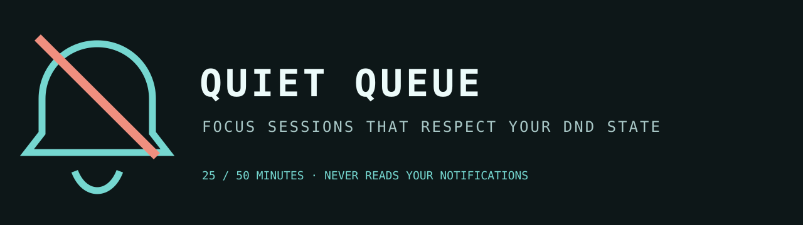
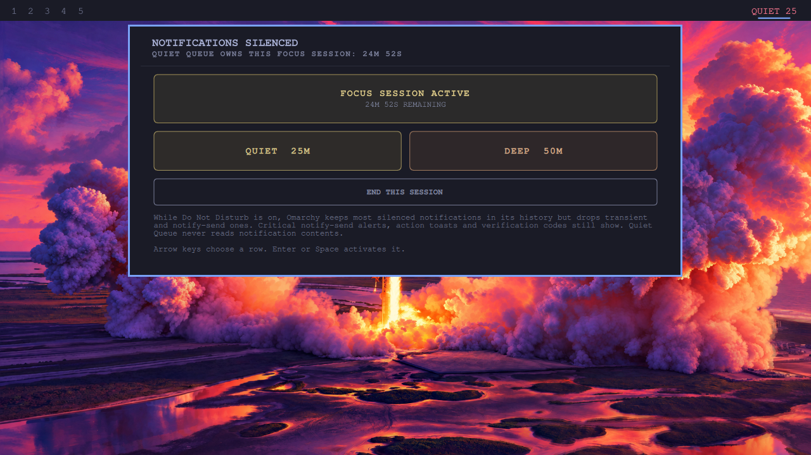

# Quiet Queue

<!-- intent-select-partner:start -->
<p><a href="https://intentsolutions.io/"></a></p>

Intent Solutions is a Claude Partner Network Select Services Partner.
<!-- intent-select-partner:end -->



[](https://ko-fi.com/U5S225PTME)

Quiet Queue gives Omarchy a focus switch you can trust. Start a 25 or 50 minute
session, watch the live countdown from the bar, and return to normal delivery
automatically when the session expires.



It uses Omarchy's native notification Do Not Disturb service and never reads
notification contents. What Do Not Disturb hides is Omarchy's decision, not
Quiet Queue's. On Omarchy `74de104`, while it is on:

- Most notifications get no popup and are recorded in Omarchy's history.
- Transient notifications, and those sent by `notify-send`, are dropped and not
  recorded.
- Critical `notify-send` alerts, Omarchy's own action toasts, and verification
  codes still show.

That behaviour comes from `shell/plugins/notifications/Delivery.js` and
`Service.qml` in Omarchy, so a later Omarchy can change it. Quiet Queue does not
store, replay, or discard notifications itself.

The ownership rule is the important part: it turns Do Not Disturb off only when
it turned it on. If Do Not Disturb was already active, the session ends without
changing it.

If Omarchy's Do Not Disturb state cannot be read (for example while the shell
restarts), Quiet Queue treats it as unknown, not as off. The panel says
`DND STATE UNKNOWN`, nothing is changed, and starting or ending a session is
refused until the state can be read again. A session you own survives the gap.

## Why it is different

- One click starts a bounded 25 or 50 minute focus session.
- The bar and panel show whether Quiet Queue owns DND and how much time remains.
- Repeated and concurrent starts extend one authoritative session safely.
- An external DND change revokes stale ownership at the next check, within 5
  seconds.
- An unreadable DND state is reported as unknown and never changes anything.
- Keyboard-first: open the panel, press an arrow key to show the cursor, then
  Enter or Space activates the selected row.
- No account, cloud service, or notification content access, and no runtime
  beyond what stock Omarchy ships (see Runtime dependencies).

## Install

```bash
omarchy plugin add https://github.com/jeremylongshore/omarchy-quiet-queue-entry --enable
```

Choose 25 or 50 minutes from the panel. The status remains visible until the
session ends or you explicitly stop it.

## Runtime dependencies

The helper `bin/quiet-queue` is a Perl script (`#!/usr/bin/perl`) that uses only
core modules (`Fcntl`, `File::Spec`, `IO::Handle`, `JSON::PP`) and the
`omarchy-shell` command Omarchy ships. Perl is not listed by name in Omarchy's
base packages. It is present because `git` is (`install/omarchy-base.packages`)
and Arch's `git` package depends on `perl`, which is how Omarchy's own
`omarchy-menu-select` and `omarchy-theme-bg-current` scripts can call it too. If
you removed Perl, the helper cannot run and the panel cannot show a state.

The panel uses Omarchy's QML and Quickshell runtime. Node is development-only
(tests and mutation runs) and never runs in the graphical session. No Python or
Ruby is used.

## Verify

```bash
npm test
npm run test:race
npm run test:mutation
npm run audit
bash scripts/run-plugin-gates.sh
bash scripts/check-lane-freshness.sh
npm run test:e2e
```

## Maintainers wanted

These plugins are growing, and we are looking for dependable Omarchy users who
want to review issues, test releases, and keep a plugin healthy over time. Start
with a small pull request or [open a maintainer interest issue](https://github.com/jeremylongshore/omarchy-quiet-queue-entry/issues/new?template=maintainer_interest.md&title=Maintainer%20interest%3A%20)
titled **Maintainer interest**. Tell us which plugin you use and how you want to
help. Consistent contributors can earn maintainer responsibility.

## License

MIT
